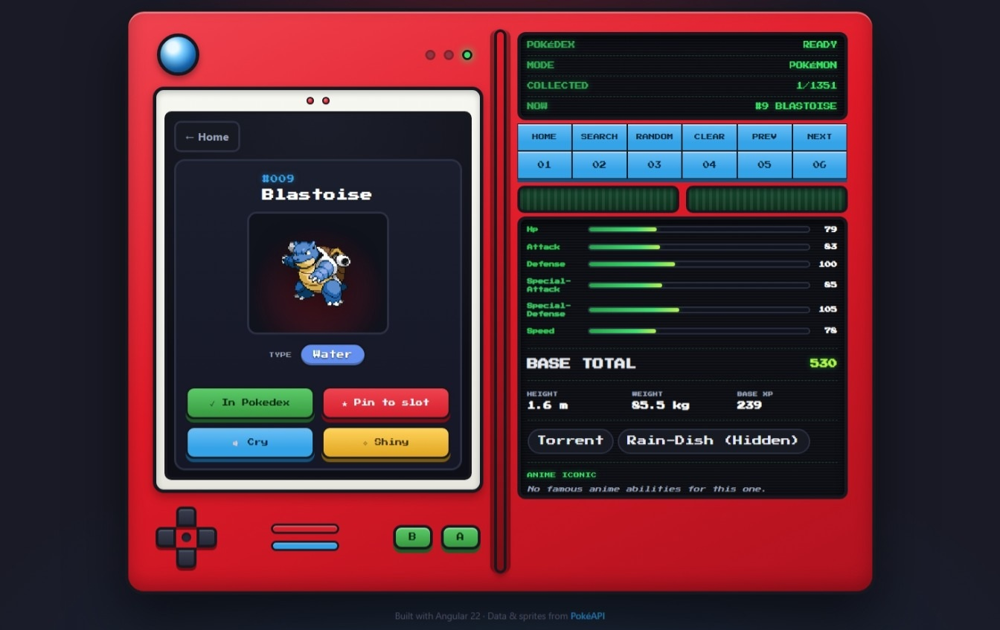

# Pokédex

<p align="center">
  
</p>

An interactive Pokémon encyclopedia presented as a physical, handheld **Pokédex console**. Browse the entire national Pokédex (Gen 1–9, 1351 species), search by name, open full details (stats, types, abilities, shiny sprite, cry), pin favourites to quick-access slots, and build your own collection — all driven by live data from [PokéAPI](https://pokeapi.co/).

  

> No API key required — everything runs in the browser.

## ✨ Features

- **Console UI** — the whole app is styled like a red Pokédex: a screen on the left, and a control deck on the right (lens, D‑pad, A/B, keypad, plus status & stats readouts).
- **Browse & search** — the **Home** screen is your collected Pokédex; the **Search** screen lists all 1351 species with client‑side name filtering.
- **Pokémon detail** — sprite with a **normal / shiny** toggle, **type badges** using the official type colours with contrast‑aware text, height / weight / base XP, base‑stat bars + total, abilities (including hidden), and **anime‑iconic ability** highlights that apply only to the Pokémon you're viewing.
- **Sound** — play each Pokémon's cry (latest, with legacy fallback).
- **Collection** — add / remove Pokémon to your Pokédex; persisted in `localStorage`.
- **Favourites (slots 1–6)** — pin any Pokémon to a slot and jump straight to it from anywhere.
- **Game‑pad style controls** — the D‑pad navigates the card grid (2D) on list screens and prev/next + scroll on a Pokémon; **A** = select/forward, **B** = back; plus a keypad with HOME / SEARCH / RANDOM / CLEAR / PREV / NEXT and the 1–6 favourites.
- **Responsive** — the device scales down and stacks for narrow / mobile widths.

## 🚀 Getting started

Requires **Node 20+**.

```bash
# install dependencies
npm install

# start the dev server (http://localhost:4200)
npm start

# production build → dist/PokedexApp
npm run build

# unit tests (Vitest)
npm test
```

## 🎮 Controls

| Control         | Action                                                                       |
| --------------- | ---------------------------------------------------------------------------- |
| **D‑pad ↑ / ↓** | Move focus through the card grid / scroll the screen                         |
| **D‑pad ← / →** | Previous / next Pokémon (on a detail screen)                                 |
| **A**           | Select: open a Pokémon, or add/remove from your Pokédex (on a detail screen) |
| **B**           | Back                                                                         |
| **HOME**        | Go to your Pokédex collection                                                |
| **SEARCH**      | Go to the search screen                                                      |
| **RANDOM**      | Jump to a random Pokémon                                                     |
| **CLEAR**       | Clear your Pokédex collection                                                |
| **PREV / NEXT** | Previous / next Pokémon                                                      |
| **1 – 6**       | Favourite quick-access slots                                                 |

## 🧱 Architecture

A single reactive service is the source of truth and the UI is signal‑driven.

```
src/app
├─ app.ts / app.html             # the device shell: screen + control deck, D‑pad/A/B/keypad logic, status & stats readouts
├─ app.routes.ts                 # routes: '' (home/collection), 'search', 'pokemon/:id'
├─ app.config.ts                 # ApplicationConfig (router, http, global error listeners)
├─ components/
│  ├─ pokedex/                   # HOME — your collected Pokédex grid (always loads, even when empty)
│  ├─ home/                      # SEARCH — all 1351 species + name filter
│  ├─ pokemon-card/              # a single card (shared by the list & search screens)
│  └─ detail/pokemon-detail/     # the Pokémon detail screen (sprite, types, stats, shiny, cry)
├─ services/pokemon.service.ts   # search list, detail, collection & favourites; signals + localStorage + PokéAPI HTTP
├─ models/pokemon.model.ts       # TypeScript models (Pokémon detail, summary, type, ability, stat)
└─ (../styles.css)               # the console / device styling
```

### Data flow

- On startup the service fetches the full national list (`/pokemon?limit=…`); search then runs **client‑side**.
- Opening a Pokémon (`/pokemon/:id`) fetches its full detail and stats. The detail page re‑fetches automatically whenever the `:id` changes, so prev/next, random, favourites and card‑to‑card jumps all work.
- Your **collection** and **favourite slots** persist across reloads via `localStorage`.

## 🧰 Tech stack

- [Angular 22](https://angular.dev) — standalone components, **signals**, and the new `@if` / `@for` / `@let` control flow
- [TypeScript ~6.0](https://www.typescriptlang.org)
- [RxJS ~7.8](https://rxjs.dev)
- [Vitest 5](https://vitest.dev) + jsdom (unit tests)
- [Prettier](https://prettier.io) (formatting)
- [PokéAPI](https://pokeapi.co/) (data) and the [PokeAPI sprites](https://github.com/PokeAPI/sprites) repo (images)

## 📁 Scripts

| Script          | Description                                   |
| --------------- | --------------------------------------------- |
| `npm start`     | Run the dev server at `http://localhost:4200` |
| `npm run build` | Production build to `dist/PokedexApp`         |
| `npm run watch` | Development build in watch mode               |
| `npm test`      | Run unit tests with Vitest                    |

## 📚 Data & attribution

Pokémon data, names and sprites are courtesy of [PokéAPI](https://pokeapi.co/) and the [PokeAPI sprites](https://github.com/PokeAPI/sprites) project. Pokémon and its name are © Nintendo / Creatures Inc. / Game Freak. This is a personal, non‑commercial project and is not affiliated with, endorsed by, or sponsored by Nintendo.
